  

  

## Este soy yo :)

Hola, soy **Miguel Vargas**, estudiante de **Análisis y Desarrollo de Software** desde Colombia 🇨🇴. Me apasiona crear aplicaciones **FrontEnd** y **BackEnd**, y siempre estoy buscando aprender nuevas tecnologías para mejorar como desarrollador.

- 🌐 **Desarrollo web moderno y escalable:** es lo que más me interesa construir.
- 🎨 **Diseño + lógica:** me gusta combinar ambos para crear soluciones eficientes.
- ☁️ **Del código al servidor:** despliego mis proyectos en AWS y Vercel, no se quedan en mi PC.
- 🧪 **Buenas prácticas:** practicando patrones, código limpio y lógica de negocio.
- 🛠️ **Construyendo en público:** proyectos reales para mi portafolio.
- 🚀 **Abierto a nuevos retos** tecnológicos. Si tienes uno, hablemos.

<h2 align="center">Mi stack</h2>

  
   
  
   
  

<h2 align="center">Proyectos destacados</h2>

  
  

| Proyecto | Qué hace | Stack | Estado |
|---|---|---|---|
| 🏟️ **GoldenBooking** | Plataforma de reservas, incluye reservas deportivas en tiempo real | Spring Boot · MongoDB · WebSocket · Vite · AWS EC2 · Vercel | [🟢 En línea](https://goldenbooking.vercel.app) |
| 🛒 **POS Supermercado** | Punto de venta: ventas, inventario, facturación, código de barras y cortes de caja, funciona sin internet | React · Spring Boot · MySQL | 🟡 En construcción |

<h2 align="center">Señales</h2>

  
  

<h2 align="center">¿Los números importan? Algo sí.</h2>

  
  
   
  

<h2 align="center">Mis contribuciones, en movimiento</h2>

  <picture>
    <source media="(prefers-color-scheme: dark)" srcset="https://raw.githubusercontent.com/miguelvargas20/miguelvargas20/output/github-snake-dark.svg"/>
    
  </picture>

<h2 align="center">Contacto</h2>

  
  

 

Hecho con ☕ y código · Miguel Vargas

